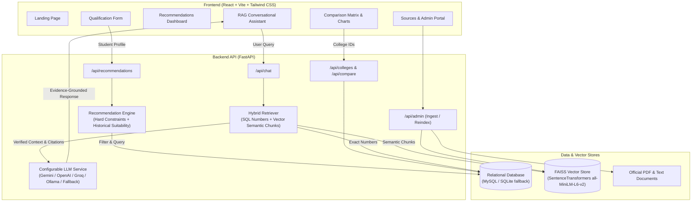

# System Architecture — College Guide AI

College Guide AI is a production-grade, full-stack AI-powered college recommendation and advising platform. It integrates a deterministic constraint & multi-criteria recommendation engine, a Retrieval-Augmented Generation (RAG) vector pipeline, and a configurable Large Language Model (LLM) assistant.

---

## 1. High-Level Architecture Diagram

---

## 2. Component Breakdown

### A. Frontend Layer
- **Framework**: React 18 with Vite for ultra-fast HMR and bundle optimization.
- **Styling**: Tailwind CSS with custom educational palette, typography, and responsive cards.
- **Navigation**: React Router v6 with clean client-side routing.
- **State Management**: React Context (`AppContext`) preserving active student profile, recommendation tiers, and comparison tray across pages.
- **Visual Analytics**: Recharts library visualizing tuition fees and audited median/highest placement packages without zero-substitutions.

### B. Backend Layer
- **Framework**: FastAPI (Python 3.13) providing asynchronous endpoints, OpenAPI Swagger documentation, and dependency injection.
- **Validation**: Pydantic v2 schemas enforcing strict bounds, positive rank checks, and conditional examination parameters.
- **Security**: Environment variable configuration (`.env`), CORS policies, and `X-Admin-Key` header authentication for document uploads and index rebuilds.

### C. Recommendation Engine
- **Step 1: Route-Specific Validation**: Validates TNEA normalized cutoff marks (40.0 - 200.0) vs JEE All India Ranks. Does not conflate ranks across differing exams.
- **Step 2: Hard Constraint Filtering**:
  - Class 12 PCM percentage eligibility.
  - Mandatory hostel availability checks when required.
  - Annual tuition and total budget caps.
  - College type preferences.
- **Step 3: Historical Suitability Estimation**:
  - Compares scores against multi-year closing cutoffs (2024, 2023).
  - Categorizes options into **Ambitious**, **Better-Matched**, **Alternative / Safe**, and **Insufficient Data**.
- **Step 4: Multi-Criteria Normalized Scoring**:
  - Combines Suitability (35%), Affordability (20%), Placements (25%), Location (10%), and Accreditation/NIRF (10%) into an index out of 100.
- **Step 5: Explainable Pros & Cons**:
  - Explicitly states strengths, trade-offs, and missing verified data alerts.

### D. RAG Pipeline
- **Document Parser**: PyPDF extracts text and section hierarchies from brochures, fee structures, and placement audits.
- **Chunking Pipeline**: Generates overlapping chunks (size ~500 words, overlap ~80 words) preserving document titles, academic years, college IDs, page numbers, and source URLs.
- **Embedding & Indexing**: SentenceTransformers (`all-MiniLM-L6-v2`) creates 384-dimensional dense vectors indexed in `faiss.IndexFlatIP` (Cosine similarity).
- **Hybrid Retrieval**: Queries SQL records for exact numerical questions (fees, cutoffs, median CTC) and combines with semantic FAISS text chunks.
- **LLM Grounding & Citations**: Passes strictly retrieved evidence to the LLM. Injects verified source URLs directly from retrieved chunk metadata.
- **Offline / Local Fallback**: When LLM API credentials are not provided, an evidence-grounded extractor answers directly from retrieved documents with official citations.
