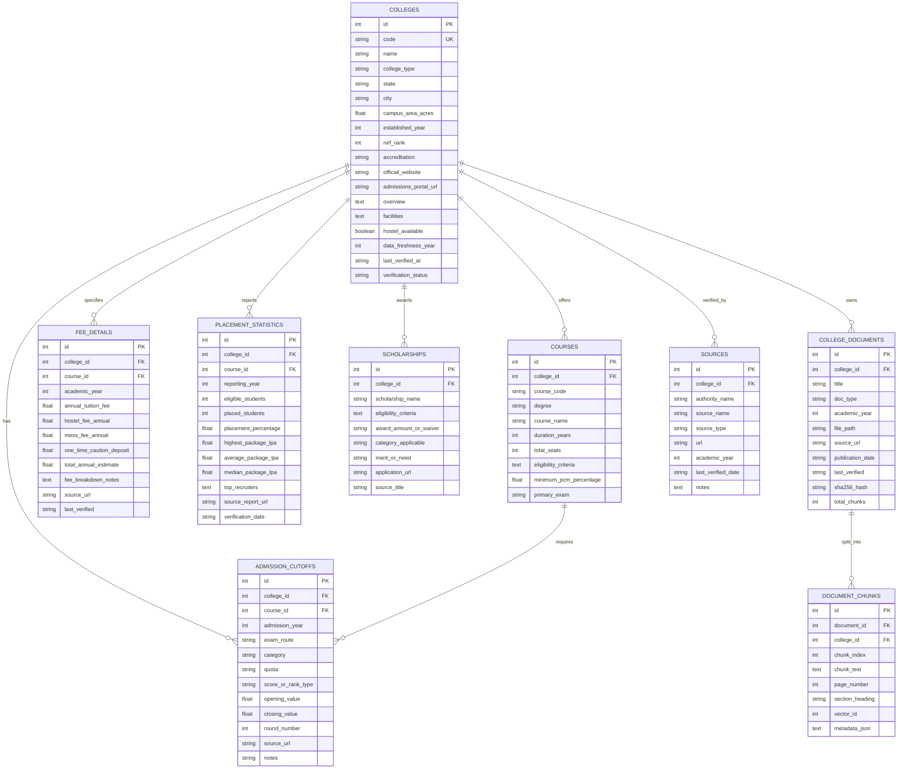

# Database Schema Documentation — College Guide AI

The relational database is normalized and designed for MySQL 8.0 (with out-of-the-box SQLite compatibility for local development).

---

## 1. Entity-Relationship Diagram

---

## 2. Table Specifications & Indexes

### 1. `colleges`
- **Primary Key**: `id` (AUTO_INCREMENT)
- **Unique Key**: `code` (e.g. `IITM`, `NITT`, `CEG-0001`, `SSN-1315`)
- **Indexes**: `name`, `state`, `city`
- **Purpose**: Stores verified institutional master data, NIRF ranks, and campus facilities.

### 2. `courses`
- **Primary Key**: `id`
- **Foreign Key**: `college_id` references `colleges(id)` ON DELETE CASCADE
- **Indexes**: `college_id`, `primary_exam`
- **Purpose**: Preserves approved programs (B.Tech / B.E.), specializations (CSE, ECE, MECH, etc.), minimum Class 12 PCM percentage thresholds, and total intake.

### 3. `admission_cutoffs`
- **Primary Key**: `id`
- **Foreign Keys**: `college_id` references `colleges(id)`, `course_id` references `courses(id)`
- **Composite Index**: `idx_cutoff_lookup (college_id, course_id, admission_year, exam_route, category)`
- **Purpose**: Preserves closing cutoff marks (out of 200 for TNEA) or All India closing ranks (for JEE), counselling rounds, and direct source archive URLs.

### 4. `fee_details`
- **Primary Key**: `id`
- **Foreign Key**: `college_id` references `colleges(id)`
- **Index**: `college_id`
- **Purpose**: Tracks annual tuition fees, hostel room rent, mess charges, one-time deposits, and total annual estimated expense.

### 5. `placement_statistics`
- **Primary Key**: `id`
- **Foreign Key**: `college_id` references `colleges(id)`
- **Purpose**: Stores verified placement percentages, median CTC packages, highest packages, and top core/IT recruiters with report URLs.

### 6. `scholarships`
- **Primary Key**: `id`
- **Foreign Key**: `college_id` references `colleges(id)`
- **Purpose**: Tracks institutional and government welfare waivers (MCM, First Graduate, SC/ST, rural talent).

### 7. `college_documents` & `document_chunks`
- **Foreign Keys**: `document_id` references `college_documents(id)` ON DELETE CASCADE
- **Indexes**: `vector_id`, `document_id`, `college_id`
- **Purpose**: Stores PDF text chunks, section headings, page numbers, and vector indices synchronized with the FAISS index.

### 8. `sources`
- **Primary Key**: `id`
- **Foreign Key**: `college_id` references `colleges(id)`
- **Purpose**: Complete audit trail of all verified counselling authorities, publication years, and verification dates.
