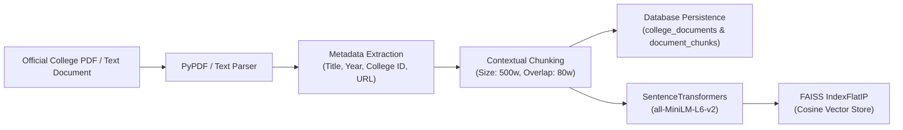
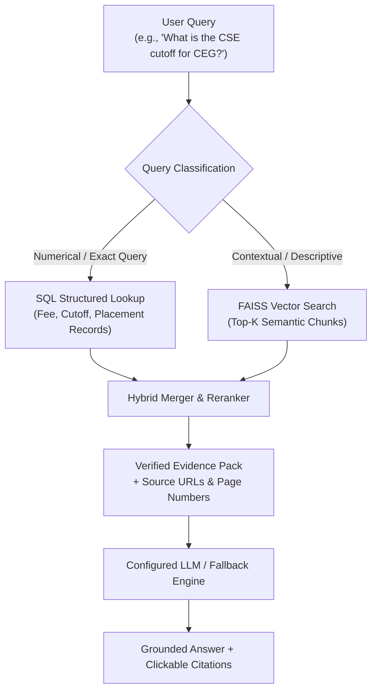

# Retrieval-Augmented Generation (RAG) Pipeline Documentation

The RAG pipeline powers College Guide AI's conversational assistant, ensuring that all factual answers regarding college eligibility, fee breakdowns, cutoffs, and scholarships are strictly grounded in verified brochures and database records.

---

## 1. RAG Ingestion Pipeline



### Steps in Ingestion:
1. **Document Loading**: PyPDF extracts text page by page from official admissions brochures, fee regulations, and placement reports.
2. **Duplicate Detection**: Computes SHA-256 cryptographic hash of incoming files. If the hash matches an existing record, redundant re-ingestion is skipped.
3. **Heading-Aware Chunking**: Chunks are generated based on logical section headings (`# Heading`), preserving semantic context and page numbers.
4. **Embedding Generation**: Uses `all-MiniLM-L6-v2` (384-dimensional dense vectors) to convert chunk text into embeddings.
5. **FAISS Indexing**: Embeddings are normalized and stored in `faiss.IndexFlatIP` for inner product (cosine similarity) search.
6. **Metadata Synchronization**: Stores vector ID to chunk ID mappings in `chunks_metadata.json` and SQL tables.

---

## 2. Hybrid Retrieval Architecture



### Why Hybrid Retrieval?
Pure vector search can misinterpret exact numerical boundaries (e.g. distinguishing ₹50,000 tuition from ₹1,50,000 total expense, or cutoff 199.50 vs 199.00). 
College Guide AI implements **Hybrid Retrieval**:
- Exact numerical questions (fees, cutoffs, placements) execute parameterized SQL queries against verified tables.
- Semantic questions (eligibility rules, hostel facilities, scholarships) query the FAISS vector index.
- Results are merged with explicit source URLs and passed to the LLM.

---

## 3. Grounded Prompt Engineering

The LLM receives:
1. System prompt strictly forbidding hallucinations or invented facts.
2. Active student profile (exam, rank, category, budget) if present.
3. Verified evidence snippets with source URLs and titles.
4. Conversation history (up to last 4 exchanges) for context.

```
SYSTEM PROMPT RULES:
1. Answer ONLY using the retrieved facts and documents provided.
2. If evidence is missing, state: "Based on verified official documents in our database, this is not documented."
3. Do not promise or guarantee admission.
4. Distinguish TNEA marks (out of 200) from JEE ranks.
5. Citations must reference provided URLs.
```

---

## 4. RAG Evaluation Metrics

The test suite in `backend/tests/test_rag.py` measures:
- **Retrieval Relevance**: Correctly retrieves verified SQL records for tuition and cutoffs.
- **Citation Integrity**: All citations originate from real database URLs; no synthetic links.
- **Handling of Missing / Unsupported Queries**: Returns honest boundaries instead of fabricating data.
